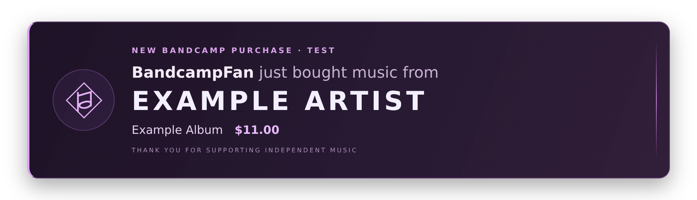

# Bandcamp OBS Alerts

Free, open-source Bandcamp purchase alerts for OBS on **macOS**.

A lightweight local helper watches Bandcamp artist sale receipts in Gmail and sends a silent, transparent thank-you overlay to OBS. Choose your own artist name. No Bandcamp API account, OBS plugin, subscription, hosted service, or custom CSS setup is required.



## Download and install

Download **[bandcamp-obs-alerts-mac-v1.0.1.zip](https://github.com/liteyear/bandcamp-obs-alerts/releases/download/v1.0.1/bandcamp-obs-alerts-mac-v1.0.1.zip)** from the **[Releases page](https://github.com/liteyear/bandcamp-obs-alerts/releases/latest)**. **GitHub's “Download ZIP” is source code**, and does not include the preinstalled dependencies in the release package.

Requirements: macOS 11 or newer, Intel or Apple Silicon, OBS with Browser Source support, an internet connection, and a Gmail account that receives your Bandcamp artist sale emails and supports Google app passwords. Windows and Linux desktop installers are not included.

1. Unzip the release package. Keep its folder intact.
2. Double-click **Start Bandcamp Alerts.command**. First launch downloads a checksum-verified Node.js runtime from nodejs.org and opens a local setup page. A Terminal window opens, but you do not need to type commands.
3. Enter your **artist name exactly as it appears on the purchased item in a sale receipt (after “by” or before the item title)**. This determines both receipt matching and the on-screen artist name. Artist names containing punctuation and Unicode characters are supported. One artist is watched per installation.
4. Enter the Gmail address that receives the artist's Bandcamp sale receipts. It may be the email associated with your PayPal account; check an actual sale notification rather than guessing.
5. Create a Google app password for that same Gmail account and enter it in the setup page. Click **Connect Gmail**.
6. Add an OBS Browser Source named **Bandcamp OBS Alerts**. Paste the URL from the setup page. Set **width 900**, **height 260**, and **30 FPS**. Leave OBS's existing Custom CSS alone.
7. Leave **Shutdown source when not visible** and **Refresh browser when scene becomes active** unchecked. Click **Send a test alert**.
8. In additional scenes, use **Add Existing → Bandcamp OBS Alerts**. Keep the source above your video layers. It is transparent between alerts.

### Google app password

Sign in to the account receiving the sale emails. Enable [2-Step Verification](https://myaccount.google.com/signinoptions/two-step-verification), then open [Google App Passwords](https://myaccount.google.com/apppasswords). Create a password named **Bandcamp OBS Alerts** and paste its 16 characters into the helper. Spaces are accepted. Do not use your regular Gmail password or put credentials in GitHub issues.

The credential is saved in the current Mac user's Keychain. A Google app password grants mail access to that Gmail account; it is not scoped to Bandcamp messages. This helper only requests newly arrived Bandcamp messages, uses a read-only mailbox, and never marks them read. App passwords can be unavailable on managed accounts, Advanced Protection accounts, and some security-key configurations. This release does not implement Google OAuth or other email providers.

### macOS blocks the launcher

This package is not Apple signed or notarized. Try Finder → right-click the launcher → **Open**. On newer macOS versions, after trying to open it, use **System Settings → Privacy & Security → Open Anyway** if offered. Do not disable Gatekeeper system-wide. If Terminal says permission denied after extracting the release, check that you downloaded the release asset and kept the executable launcher intact.

## Daily use

Launch **Start Bandcamp Alerts.command** before streaming. A second launch opens the control page of the already-running helper. After it starts, you can close Terminal and the browser control window. The helper stays running until you click **Quit alert helper** or shut down the Mac. It does not start at login or launch OBS automatically.

The overlay reads:

> BandcampFan just bought music from
> YOUR ARTIST NAME
> Example Album · $11.00

Hide the username and/or amount, and choose a display duration from 5–20 seconds. Hidden usernames are replaced by **Someone**. Alerts are silent so they do not interrupt a music stream. There are no continuously running visual effects or high-frequency browser polls. Actual CPU use depends on the Mac, OBS scene, and other applications.

To change artists, disconnect Gmail first, change the artist name, and reconnect. Your private OBS URL remains stable across launches. Updating the app also preserves the connection and preferences: quit the running helper, unzip the new release, and launch it from the new folder.

## Purchase detection and limits

- Gmail IMAP IDLE wakes the helper on incoming mail; a once-a-minute status check backs it up.
- Only `noreply@bandcamp.com` messages with a passing DKIM result for `bandcamp.com` or `email.bandcamp.com` from Gmail are accepted.
- Receipt matching uses the **artist on the purchased item**, so a label greeting or shared inbox can have a different recipient name.
- The parser supports both the `item by Artist` / `This sale was completed on` layout and the artist-first `Artist, Item, digital track/album` layout with a Bandcamp transaction footer, in plain text or HTML. The latter was verified against a supplied real track-sale email. The displayed amount is the total paid in the receipt, including tax when present. **merch, gifts, subscriptions, baskets, alternate languages, and changed receipt layouts have not been validated**. Unrecognized messages are ignored.
- Payout notifications, refunds, and zero-price downloads do not create purchase alerts.
- Detection begins with **new mail** each time the helper starts or you explicitly reconnect. Old emails and purchases received while it was stopped are skipped.
- Brief network interruptions within a running session catch up after reconnecting. Pending alerts are kept in memory, not replayed after a restart.
- Duplicate receipts are suppressed using hashed identifiers, retaining the latest 2,000. Up to 100 alerts can wait in the queue.
- A purchase is detected when its receipt reaches Gmail. Bandcamp and email delivery delays can delay the alert.
- This is an independent tool, not an official Bandcamp, Google, or OBS integration.

**Test the full connection before a live stream:** after connecting, make a small new purchase and confirm one correctly labeled alert. The test button only checks the overlay. A previous artist-specific build was reported working by its user; this configurable public build still needs a real purchase test on each user's account.

## Privacy, disconnect, and uninstall

Buyer email addresses, payment-account real names, shipping details, fees, and payouts are never added to the overlay. A public Bandcamp username can itself be a person's name; hide usernames if preferred. The helper does not save email bodies or buyer details. It stores Gmail account address, preferences, private viewer key, and hashed receipt identifiers locally.

The helper listens only on **127.0.0.1:17864**. The OBS viewer key cannot access the setup API. A separate temporary key protects the control page. Keep your source URL private.

Click **Disconnect Gmail & remove saved credential** to remove its Keychain entry. You may also revoke the app password in your Google account. To uninstall, disconnect Gmail, quit the helper, remove the OBS source, and delete the extracted release folder and `~/Library/Application Support/Bandcamp OBS Alerts`.

## Build from source

Developers need Node.js 22 or newer and Python 3 for release packaging:

```sh
npm ci --ignore-scripts
npm test
python3 scripts/build_release.py
```

This creates an end-user Mac ZIP, a source ZIP without dependencies, and SHA-256 checksums in `dist/`. Both archives use an explicit file allowlist. Credentials, runtime downloads, logs, local settings, `.git`, and build outputs are never included.

Credential-free preview:

```sh
BCA_DEMO=1 BCA_DATA_DIR=/tmp/bandcamp-obs-demo node server.cjs
```

Open the private control URL written to `/tmp/bandcamp-obs-demo/control-url.txt`. Enter a sample artist and save preferences, then open the overlay preview and send a test. Demo mode never connects to Gmail.

The GitHub Actions CI file runs tests on Node.js 22 and 24, checks launcher syntax, and verifies release packaging. See [RELEASING.md](RELEASING.md) for publishing instructions. The launcher pins Node.js v22.23.3; update its runtime version and both SHA-256 checksums together when updating it.

## Contributing

See [CONTRIBUTING.md](CONTRIBUTING.md). To report an unrecognized receipt layout, describe the item type and redact buyer/account details. Do not post credentials, full email headers, or your OBS URL. See [SECURITY.md](SECURITY.md) for security reporting.

Created by **Liteyear Design**. Released under the [MIT License](LICENSE). Third-party dependency licenses remain in their bundled packages; see [NOTICE.md](NOTICE.md).
